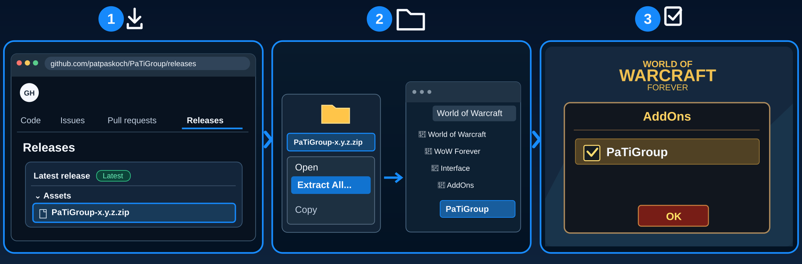

# PaTiGroup


## Install

**📥 [Download PaTiGroup Beta](https://github.com/patpaskoch/PaTiGroup/releases/download/v0.1.0-beta.1/PaTiGroup-0.1.0-beta.1.zip)** · [Installation guide](#installation)

*Installation-test preview — not yet a stable release.*

## What is PaTiGroup?

**Know your team. Follow your tank. Stay together.**

Figuring out who to follow or which enemy to focus shouldn't slow you down. PaTiGroup keeps your tank, healer and the tank's current target together in one compact view — so your party stays on the same page.

## Features

- **Your key teammates:** Spot the tank and healer at a glance.
- **Tank's target:** See the enemy's portrait and raid marker.
- **Quick targeting:** Click a teammate or the tank's target; right-click the target to attack.
- **Party awareness:** Clear role and member status in a compact view.

## Installation



1. 📥 **Download** – Open [GitHub Releases](https://github.com/patpaskoch/PaTiGroup/releases) and download the `PaTiGroup-<version>.zip` file under **Assets** (not **Source code (zip)**).
2. 📂 **Extract & Copy** – Right-click the ZIP, select **Extract All**, then copy the extracted `PaTiGroup` folder into the WoW Forever client's `Interface/AddOns/` folder. No renaming is needed.
3. ☑️ **Enable in Game** – Start WoW, open the **AddOns** menu at character selection, tick **PaTiGroup**, and click **OK**.

**Updating an older installation?** Replace the old `PaTiGroup` folder completely.

## Getting Started

- Use `/pg` to open or hide the group window.
- Join a party to see the tank, healer and the tank's target; use `/pg test` for example data.

## Settings

Open `/pg settings` or the window's menu to configure the addon. Use `/pg lock` or `/pg unlock` to control window movement.

## Important notes

> **Installation-test beta available:** [Download the current ZIP from Releases](https://github.com/patpaskoch/PaTiGroup/releases). This is an unverified preview for testing the installation, not a stable release.

> Status: in development, not yet stable. Not yet tested in game.
>
> This is a **new** PaTiGroup (2026-10-02). The former PaTiGroup (raid markers, ready check, pull timer) is now
> [PaTiLead](https://github.com/patpaskoch/PaTiLead). Old PaTiGroup settings are not taken over.

## Preview

```
┌ PaTiGroup                         ••• ┐
│ Tank Patrick      Heiler Stefanie     │
│ Tankziel                              │
│ [face] ☠ Dunkler Kultist              │
└───────────────────────────────────────┘
```

## Feature details

- **Tank and healer** in one line: the names (you first, if you tank yourself), each with "dead" or "offline" when
  WoW reports it, "+1" when there are more tanks or healers. **Click a name to target that player**
  (macro: `/click PaTiGroupTankButton` or `/click PaTiGroupHealerButton`)
- **Tank target** (below tank and healer, highlighted): what the tank has targeted, with the enemy's portrait and its raid marker; "no target" when there is none.
  **Left click: only target that enemy**, **right click: target it and attack** (/target + /startattack) —
  also in combat: the click takes what the tank has targeted at
  that moment. Key binding: a macro with `/click PaTiGroupTankTargetButton` (= left click: only target). Not shown when you are the tank
- Party and raid; solo: "Not in a group"
- Roles come from WoW (role check / group finder). Without assigned roles nobody shows as tank or healer ("-") — PaTiGroup never
  guesses a role from the class. Unreadable (restricted) values are never guessed either.
- Updates normally in combat. The click button is set up out of combat, so in combat the window cannot be moved,
  collapsed or hidden (after a roster change in combat the click follows when combat ends).
- ••• menu: Settings, Lock, Collapse, Test Mode, Hide. Settings: language, scale, lock, panel opacity.
  Languages: English, Deutsch (others fall back to English)

Not part of PaTiGroup: raid markers, ready check, pull timer and other leader actions (→ PaTiLead), threat and aggro
(→ PaTiAggro), HoTs and heal details (→ PaTiHeal).

## PaTiSuite

This addon is part of the **PaTiSuite** — a collection of small addons for World of Warcraft: Forever.
Each one is installed on its own and works on its own; none of them is needed by another.

- [PaTiSuite](https://github.com/patpaskoch/PaTiSuite) – optional control panel to show and hide the PaTi windows
- [PaTiHeal](https://github.com/patpaskoch/PaTiHeal) – healing: party frames, heal target, click casting, HoTs, dispels
- [PaTiAuras](https://github.com/patpaskoch/PaTiAuras) – buffs, procs, tracking, group buffs and weapon imbues
- [PaTiAggro](https://github.com/patpaskoch/PaTiAggro) – aggro for tank, healer and damage (formerly PaTiTank)
- [PaTiRota](https://github.com/patpaskoch/PaTiRota) – your own skill priority with cooldowns and fixed cast buttons
- **PaTiGroup** – party awareness: tank, healer and the tank's target *(this addon)*
- [PaTiLead](https://github.com/patpaskoch/PaTiLead) – lead the group: raid markers, ready check and pull timer
- [PaTiQuest](https://github.com/patpaskoch/PaTiQuest) – selected quest and its objectives
- [PaTiDungeon](https://github.com/patpaskoch/PaTiDungeon) – instance, group and combat status
- [PaTiSocial](https://github.com/patpaskoch/PaTiSocial) – "Party Social": quick emote and message buttons
- [PaTiAlerts](https://github.com/patpaskoch/PaTiAlerts) – one window for open problems

### Goes well with (optional)

- [PaTiLead](https://github.com/patpaskoch/PaTiLead) – the leader sets the markers PaTiGroup shows
- [PaTiSuite](https://github.com/patpaskoch/PaTiSuite) – shows and hides this window together with the other PaTi windows

## Commands

`/pg`, `/ptg` or `/patigroup` — alone or `toggle`: show/hide · `settings` · `test` · `show` · `hide` · `lock` ·
`unlock` · `reset` (position) · `debug` · `version`

## Known limitations

- Not tested in game yet. Whether the Forever client reports roles without the group finder is unconfirmed
  (`/pg debug` lists every member's role).
- The tank's target of another player is read from `party1target` etc.; out of range it may show "no target".

## Development

Architecture, tests and engineering rules of the suite: [PaTiAdmin](https://github.com/patpaskoch/PaTiAdmin). PaTiAdmin is not a WoW addon — players do not install it. The shared UI code (PaTiShared) is already embedded in this addon's `Shared/` folder; there is nothing extra to install.

## License

MIT — see [LICENSE](LICENSE). Copyright (c) 2026 Patrick Koch.
